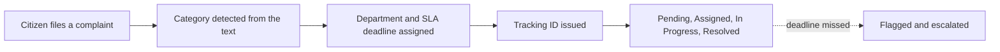

# ONOCP: One Nation, One Complaint Portal

File a civic complaint once. ONOCP detects the category, routes it to the right department, sets a deadline that department has to meet, and gives the citizen an ID to track it until it is resolved.

**[Live app](https://bucolic-biscuit-32279d.netlify.app/)** · **[API docs](https://onocp.onrender.com/docs)**

> The backend runs on a free Render instance. If it has been idle, the first request can take about a minute to wake up.

## Why this exists

Citizens in India often do not know which department owns a problem: a pothole, a broken streetlight, a water leak. ONOCP removes that step. The citizen describes the problem in plain words, in their own language, and the system does the routing.

## Features

**For citizens**
- Submit a complaint with a title, description, location (pin on a map or a landmark) and an optional video recorded in the browser
- Automatic category detection and department routing, with an option to correct the category
- Tracking ID (for example `ONOCP-AB12CD`) and a receipt showing the department and the deadline
- Status you can follow: Pending, Assigned, In Progress, Resolved
- Public heatmap showing where each kind of complaint is coming from

**For administrators**
- Dashboard with totals, pending, resolved and SLA-breached counts
- Filter by status and department, and update status inline
- Complaints past their deadline are flagged and marked as escalated

**For everyone**
- 11 interface languages: English, Hindi, Hinglish, Marathi, Bengali, Tamil, Telugu, Gujarati, Kannada, Malayalam and Punjabi, on both the citizen and admin pages
- Maps are limited to India and a pin cannot be placed outside it
- Responsive layout, keyboard focus styles and reduced-motion support

## How it works



### Smart routing

`backend/routing.py` holds a `CATEGORY_CONFIG` dictionary. Each category has a department, an SLA in days, a map colour and a keyword list. `detect_category()` scores the complaint text against those keywords and picks the best match. Romanised Hindi words such as `pani`, `bijli`, `sadak`, `kachra` and `chori` are included, so complaints written in Hinglish are routed too. If nothing matches, the complaint goes to General Administration.

| Category | Department | SLA |
|---|---|---|
| Water Supply | Municipal Water Board | 3 days |
| Electricity | State Electricity Board | 2 days |
| Roads & Infrastructure | Public Works Department (PWD) | 7 days |
| Sanitation & Garbage | Municipal Sanitation Department | 3 days |
| Health Services | Department of Public Health | 2 days |
| Police & Safety | Local Police Station | 1 day |
| Public Transport | Regional Transport Authority | 5 days |
| General Administration (fallback) | General Administration Cell | 5 days |

The keyword matcher is deliberately simple. `detect_category()` is the only function that needs to change to swap in an embeddings-based or fine-tuned classifier.

To add a category, add one entry to `CATEGORY_CONFIG`. The dropdown, routing, deadline and heatmap colour all follow from it.

## Tech stack

| Layer | Technology |
|---|---|
| Backend | FastAPI, SQLAlchemy, SQLite, Pydantic |
| Frontend | One HTML file with vanilla JavaScript, no build step |
| Maps | Leaflet with Esri tiles (falls back to OpenStreetMap) |
| Fonts | Baloo 2, Public Sans, JetBrains Mono, Noto Sans for Indic scripts |
| Hosting | Render (API), Netlify (frontend) |

## Project structure

```
onocp/
├── backend/
│   ├── main.py            # FastAPI app, database model, routes
│   ├── routing.py         # categories, departments, SLAs, keyword detection
│   └── requirements.txt
├── frontend/
│   └── index.html         # the whole UI: styles, translations, app logic
└── README.md
```

## Run it locally

### 1. Backend

```bash
cd backend
pip install -r requirements.txt
uvicorn main:app --reload
```

The API runs at `http://127.0.0.1:8000` and interactive docs are at `http://127.0.0.1:8000/docs`. On first run it creates `onocp.db` and an `uploads/` folder next to `main.py`.

### 2. Frontend

Open `frontend/index.html` in a browser, or use the VS Code Live Server extension.

The frontend talks to the hosted API by default. To use your local backend, find this line in the script and change it:

```js
const API = "https://onocp.onrender.com";   // change to "http://127.0.0.1:8000"
```

### 3. Admin page

The Admin tab is hidden by default. It appears when the page is opened with `?admin=<key>` in the URL, where the key is the `ADMIN_KEY` value in `frontend/index.html`. See [Security notes](#security-notes) before relying on this.

## API reference

| Method | Endpoint | What it does |
|---|---|---|
| `POST` | `/api/complaints` | Create a complaint. Returns the tracking ID, category, department and deadline |
| `POST` | `/api/complaints/{id}/video` | Attach a video (multipart field `video`) |
| `GET` | `/api/complaints` | List complaints. Optional filters: `status`, `department`, `category` |
| `GET` | `/api/complaints/track/{tracking_id}` | Look up one complaint by its tracking ID |
| `PATCH` | `/api/complaints/{id}` | Update status (`Pending`, `Assigned`, `In Progress`, `Resolved`) |
| `GET` | `/api/complaints/heatmap` | Geo-tagged complaints with colours, for the map |
| `GET` | `/api/stats` | Totals by status and department, plus the overdue count |
| `GET` | `/api/categories` | List of category names |

Example request:

```bash
curl -X POST https://onocp.onrender.com/api/complaints \
  -H "Content-Type: application/json" \
  -d '{"title": "Pothole near market road", "description": "Deep pothole, two-wheelers are slipping", "lat": 19.07, "lng": 72.87}'
```

### Data model

A `Complaint` has: `tracking_id`, `title`, `description`, `category`, `department`, `status`, `location_text`, `lat`, `lng`, `citizen_contact`, `created_at`, `updated_at`, `deadline`, `escalated` and `video_url`. A complaint counts as overdue when it is not Resolved and the current time is past `deadline`.

## Languages

All interface text lives in the `T` object in `frontend/index.html`, one block per language. The choice is saved in the browser, and Indic fonts load only when needed.

To add a language:
1. Add a `T['xx'] = { ... }` block, copying the keys from the English one. Any missing key falls back to English.
2. Add an entry to the `LANGS` array.
3. For a new script, add its Noto Sans family to `FONT_FOR`.

Category and department names come from the backend in English and are not translated yet.

## Deployment

**Backend on Render** (typical settings)
- Root directory: `backend`
- Build command: `pip install -r requirements.txt`
- Start command: `uvicorn main:app --host 0.0.0.0 --port $PORT`

**Frontend on Netlify**
- Publish directory: `frontend`
- No build command

Pushing to `main` redeploys both if the services are connected to this repository.

## Security notes

This is a prototype, so a few things are intentionally open:

- The Admin tab is only hidden, not protected. The key is in the frontend source, and the admin API endpoints accept requests from anyone. Real admin login is the first item on the roadmap.
- CORS allows all origins (`allow_origins=["*"]`) and should be restricted in production.
- Uploaded videos are not size-limited or type-checked.
- On a free Render instance the disk is temporary. The SQLite database and uploaded videos can be lost on a restart or redeploy. Use a managed Postgres database and object storage for anything real.

## Roadmap

- [ ] Admin login with JWT and role-based access
- [ ] Replace keyword matching with an embeddings-based or fine-tuned classifier
- [ ] Notifications by SMS, email or WhatsApp when a status changes
- [ ] Geocode a typed landmark into coordinates automatically
- [ ] Postgres and cloud storage for videos
- [ ] Upload limits, validation and rate limiting
- [ ] Translate category and department names
- [ ] India boundary outline on the maps, to restrict pins to the exact border

## Author

Built by Krishnakanth · [@KRSNA444](https://github.com/KRSNA444)
